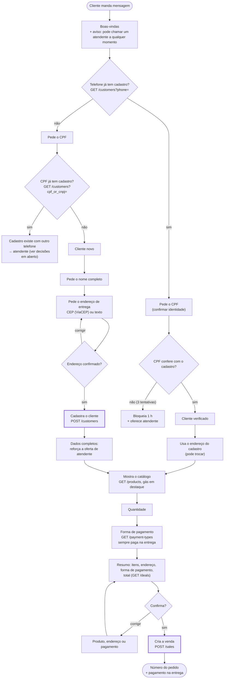
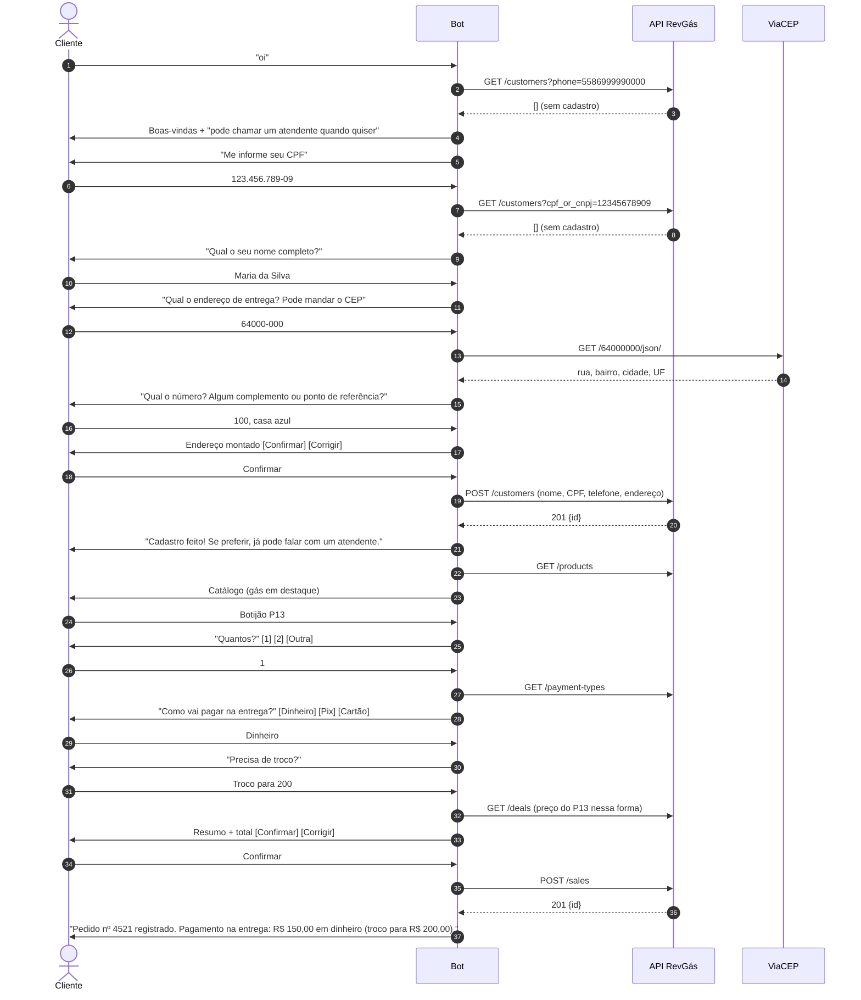
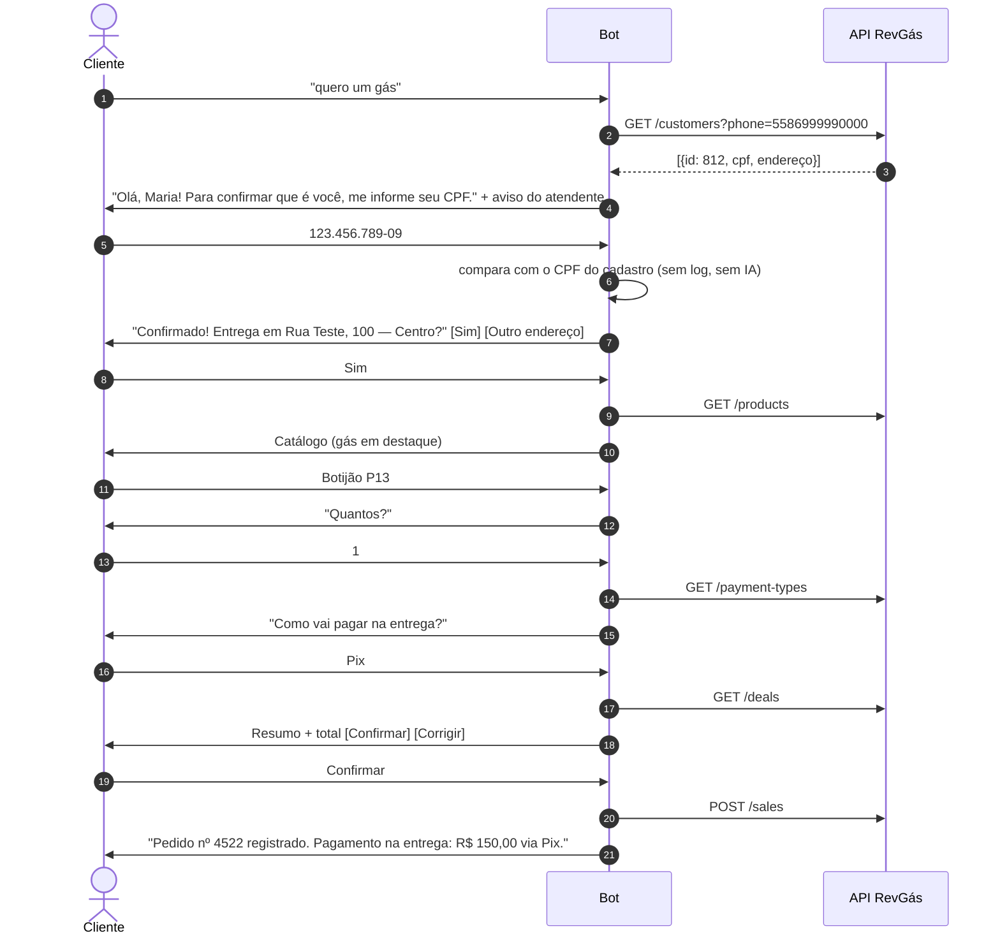
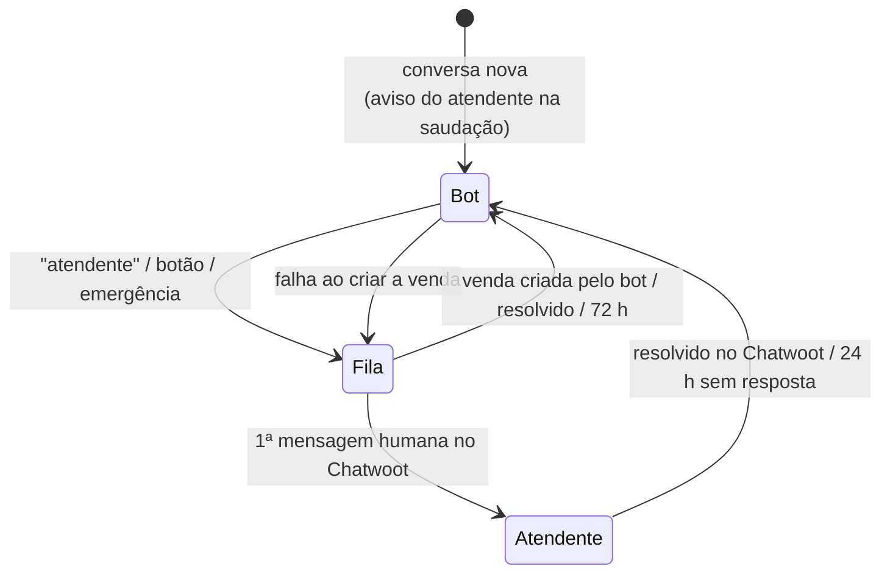
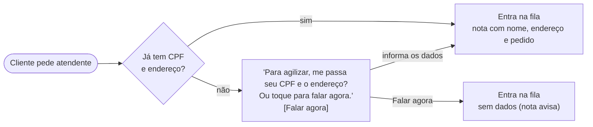

# Fluxo do sistema — v2 (requisitos de 2026-11-24)

> Desenho alvo do atendimento no WhatsApp a partir dos requisitos revisados em 2026-11-24. O
> fluxo implementado hoje está em [fluxo.md](fluxo.md); a seção
> [O que muda em relação ao fluxo atual](#o-que-muda-em-relação-ao-fluxo-atual) lista as diferenças.
> A API RevGás disponível é de **teste** (sandbox), então cadastros e vendas nela não têm efeito real.

## Resumo em uma tela

| | Cliente novo | Cliente que já usou o sistema |
| --- | --- | --- |
| Identificação | Telefone não encontrado e CPF não encontrado | Telefone encontrado (ou CPF encontrado) |
| O que o cliente informa | Nome, CPF e endereço de entrega | Só o CPF, para confirmar a identidade |
| Cadastro na RevGás | `POST /customers` com dados e endereço | Nenhum (usa o cadastro existente) |
| Produto | Catálogo completo, com o gás em destaque | Igual |
| Pagamento | Forma escolhida, **sempre paga na entrega** | Igual |
| Atendente humano | Oferecido em toda conversa nova; de preferência depois dos dados e do endereço | Igual |

## Visão geral



Em qualquer ponto, "atendente", "humano" ou o botão **Falar com atendente** levam ao Chatwoot (ver
[Atendente humano](#atendente-humano-chatwoot)). As regras de emergência de gás, palavrões, cancelar e
lembrete de pedido parado continuam as do [fluxo atual](fluxo.md#comandos-globais).

---

## Fluxo 1 — cliente novo

### Sequência



### Etapas

| # | Etapa | Bot pergunta | Cliente responde | Validação | API |
| --- | --- | --- | --- | --- | --- |
| 1 | Boas-vindas | Saudação + aviso do atendente | — | — | `GET /customers?phone=` |
| 2 | CPF | "Me informe seu CPF" | CPF com ou sem máscara | 11 dígitos e dígitos verificadores | `GET /customers?cpf_or_cnpj=` |
| 3 | Nome | "Qual o seu nome completo?" | Texto | Nome e sobrenome, até 100 caracteres | — |
| 4 | Endereço | "Qual o endereço de entrega? Pode mandar o CEP" | CEP ou endereço em texto | CEP no ViaCEP; texto lido pela IA | ViaCEP |
| 5 | Campos que faltaram | Número, complemento, ponto de referência | Texto | Número obrigatório | — |
| 6 | Confirmar endereço | Endereço montado | Confirmar / Corrigir | — | — |
| 7 | Cadastro | (nenhuma pergunta) | — | Resposta 201 da RevGás | `POST /customers` |
| 8 | Catálogo | Lista de produtos, gás primeiro | Produto | Produto ativo e com estoque | `GET /products` |
| 9 | Quantidade | "Quantos?" | 1, 2 ou número | 1 a 10, até o estoque | — |
| 10 | Pagamento | "Como vai pagar na entrega?" | Forma | Forma ativa e com preço | `GET /payment-types`, `GET /deals` |
| 11 | Troco | Só para dinheiro: "Precisa de troco? Para quanto?" | Valor | Acima do total | — |
| 12 | Resumo | Itens, endereço, pagamento na entrega, total | Confirmar / Corrigir | — | `GET /deals` |
| 13 | Venda | (nenhuma pergunta) | — | Único POST, sem retry automático | `POST /sales` |
| 14 | Fim | Número do pedido e lembrete do pagamento na entrega | — | — | — |

**Por que o CPF vem antes do nome:** o CPF decide se a pessoa é nova. Se o CPF já existe na RevGás
com outro telefone, não faz sentido pedir nome e endereço de novo.

**Dados do cadastro (`POST /customers`):**

| Campo RevGás | Origem | Formato |
| --- | --- | --- |
| `name` | Etapa 3 | Texto |
| `cpf` | Etapa 2 | 11 dígitos, sem máscara |
| `phones` | Telefone do WhatsApp | `["5586999990000"]` (com DDI 55) |
| `location`, `number`, `neighborhood`, `city`, `state_federation`, `postal_code` | Etapas 4–5 | CEP com 8 dígitos |
| `complement`, `landmark` | Etapa 5 | Opcionais |
| `type` | Fixo | `PHYSICAL` |

O endereço fica **no próprio cadastro** do cliente: a API RevGás não tem endpoint de endereços
separados. O endereço da entrega também vai no corpo da venda.

---

## Fluxo 2 — cliente que já usou o sistema

### Sequência



### Etapas

| # | Etapa | Bot pergunta | Cliente responde | Regra |
| --- | --- | --- | --- | --- |
| 1 | Identificação | — | — | `GET /customers?phone=` encontra o cadastro |
| 2 | Confirmar identidade | "Me informe seu CPF" | CPF completo | Compara com o `cpf` do cadastro. 3 erros bloqueiam o telefone por 1 h e oferecem o atendente |
| 3 | Endereço | "Entrega em {endereço do cadastro}?" | Sim / Outro endereço | "Outro endereço" segue as etapas 4–6 do cliente novo e atualiza o cadastro (`PUT /customers/{id}`) |
| 4 | Catálogo | Igual ao cliente novo | Produto | — |
| 5 | Quantidade | Igual | Número | — |
| 6 | Pagamento | Igual | Forma | Sempre paga na entrega |
| 7 | Resumo e venda | Igual | Confirmar | `POST /sales` |

- **Validade da verificação:** depois de acertar o CPF, o telefone fica verificado por 15 dias (regra
  atual); nesse prazo o bot não pede o CPF de novo.
- **Repetir último pedido:** continua possível depois da verificação (ver
  [fluxo.md](fluxo.md#repetir-último-pedido)), sempre passando pelo resumo e pelo "Confirmar".
- **Cadastro sem CPF:** o bot não consegue confirmar a identidade; oferece o atendente.

---

## Catálogo com foco no gás

O cliente vê o catálogo inteiro, mas o fluxo é pensado para a compra de gás:

```
🔥 Gás de cozinha
   GLP 13 kg .................. R$ 150,00
   GLP 45 kg .................. R$ 100,00
Outros produtos
   Regulador de pressão
   Mangueira
```

(Valores da API de teste em 2026-11-24; o preço do 45 kg lá é dado de teste.)

- **Ordem:** produtos de gás primeiro (descrição começando com `GLP`), depois o resto. Na API de
  teste o gás é `GLP 13KG ENVASADO NO BOTIJÃO` (23740), `GLP 13KG NORMAL` (24230) e `GLP 45KG MA`
  (23974).
- **Vasilhame não é pedido de gás:** `VASILHAME 13KG`/`45KG` é o casco vazio (compra do botijão). Não
  aparece na lista de gás; só se o cliente pedir o botijão novo.
- **Preço:** `GET /products` não traz preço. O preço de referência vem do acordo base
  (`GET /deals` sem cliente) e o valor final depende da forma de pagamento; o total definitivo só
  aparece no resumo.
- **Estoque:** só aparecem produtos ativos com estoque (`stock_quantity > 0`).
- **Texto livre:** "quero um gás" ou "um P13" já escolhe o produto (IA + catálogo); "gás" sem
  tamanho mostra só os botijões.

## Pagamento sempre na entrega

O cliente escolhe **como** vai pagar, mas o pagamento acontece **sempre na entrega**, nas mãos do
entregador. O bot não gera cobrança, link ou QR Code.

| Forma (`payment_type`) | Na entrega | Pergunta extra |
| --- | --- | --- |
| `MONEY` (dinheiro) | Paga ao entregador | Troco para quanto |
| `PIX` | Pix na hora, para a chave/QR do entregador | — |
| `CARTAO_DE_DEBITO`, `CARTAO_DE_CREDITO` | Maquininha do entregador | — |

- O bot oferece só essas quatro. As outras formas do estabelecimento (`WALLET`, `BANKDRAFT`,
  `FETLOCK`, `CREDISHOP`, `CREDITO_CLIENTE`, `CARTAO_OUTRO`, `CARTAO_REVGAS`,
  `TRANSFERENCIA_BANCARIA`, `GAS_DO_POVO`, `VALEGAS`) não fazem sentido no WhatsApp ou têm preço de
  teste (R$ 0,01) na API.
- Das quatro, aparecem só as que têm preço para o produto (`GET /deals`, acordos `type=PAYMENT_TYPE`).
  A venda leva o `payment_type_establishment_id` da forma escolhida (na API de teste: `MONEY` 40071,
  `CARTAO_DE_CREDITO` 40077, `CARTAO_DE_DEBITO` 40080, `PIX` 40082).
- `GET /payment-types` dá 403 com a chave atual, então a lista sai dos acordos (`GET /deals`), que
  trazem `payment_type` e `payment_type_establishment_id`.
- A API não tem um campo "pagar na entrega": a venda vai com `payments[].payment_type` e o
  `observation` registra o troco. O texto ao cliente sempre diz "pagamento na entrega".

---

## Atendente humano (Chatwoot)



**Quando o bot fala do atendente**

| Momento | O que o bot diz |
| --- | --- |
| Toda conversa nova (boas-vindas) | "Se preferir, você pode falar com um atendente a qualquer momento: é só escrever *atendente*." |
| Depois do cadastro ou da verificação | Reforça a oferta com o botão **Falar com atendente** junto da próxima pergunta |
| Bot não entendeu 3 vezes, dúvida sem resposta, pedido acima de 10 unidades, falha da venda | Botão **Falar com atendente** |

**Preferência: dados antes do atendente.** O ideal é o atendente receber o cliente já identificado.
Se o cliente pede atendente **antes** de informar dados e endereço:



- O cliente **nunca** fica preso: o botão "Falar agora" entra na fila na hora. Emergência de gás
  sempre vai direto, sem pedir dados.
- A nota interna do Chatwoot leva motivo, etapa, nome, endereço e pedido; **nunca o CPF**
  (`[CPF ocultado]`).
- O resto (espelho das mensagens, estados `queued`/`active`, Chatwoot fora do ar) segue
  [fluxo.md](fluxo.md#handoff-para-atendente) e [chatwoot.md](../guides/integrations/chatwoot.md).

---

## Endpoints RevGás por etapa

| Etapa | Endpoint | Uso |
| --- | --- | --- |
| Identificar pelo telefone | `GET /customers?phone=` | 10–11 dígitos, com ou sem 55 |
| Identificar pelo CPF | `GET /customers?cpf_or_cnpj=` | Não existe filtro `cpf`; ver testes |
| Cadastrar cliente | `POST /customers` | Nome, CPF, telefone e endereço no mesmo corpo |
| Trocar endereço | `PUT /customers/{id}` | Cliente recorrente com endereço novo |
| Catálogo | `GET /products?establishment_id=&inactive=false` | Sem preço e sem categoria |
| Formas de pagamento | `GET /payment-types?establishment_id=&status=ACTIVE` | `establishment_id` obrigatório |
| Preço | `GET /deals?establishment_id=&product_id=&payment_type=` | `suggested_value` por produto e forma |
| Criar venda | `POST /sales` | `customer_id`, endereço, `products[]`, `payments[]`, `channel: WHATSAPP` |
| Conferir antes de repetir POST | `GET /sales?customer_id=&channel=WHATSAPP` | A API não tem chave de idempotência |

### Resultado dos testes na API de teste

Rodados em 2026-11-24 contra o estabelecimento 2580, com `pnpm revgas:check` (`scripts/revgas.live-check.spec.ts`)
e `scripts/revgas-customers.live-check.spec.ts`.

| Endpoint | Resultado | Observação |
| --- | --- | --- |
| `GET /establishments` | ✅ 200 | Inclui o 2580 |
| `GET /products` | ✅ 200, 10 produtos | Sem preço; nosso schema lê a resposta sem erro |
| `GET /deals` | ✅ 200, 1215 acordos | Traz `payment_type`, `payment_type_establishment_id` e `type` (`PAYMENT_TYPE` ou `TAG`); acordos `TAG` são preços por grupo de cliente |
| `GET /payment-types` | ❌ 403 | "User doesn't have access to this resource" |
| `GET /customers?phone=` | ❌ 403 | Mesmo erro |
| `GET /customers?cpf_or_cnpj=` | ❌ 403 | Não deu para saber se a busca é exata ou por prefixo |
| `POST /customers` | ❌ 403 | Nenhum cliente criado |
| `GET /customers/{id}`, CPF duplicado | ⏸ não testados | Dependem do cadastro |
| `POST /sales` | ⏸ não testado | Sem permissão conhecida (ver [revgas.md](../guides/integrations/revgas.md#permissões-atuais-da-chave)) |

**O que funciona hoje:** catálogo, preços e a lista de formas de pagamento (tirada dos acordos).
**O que falta:** a chave precisa de permissão em `customers` (ler e criar) e, de preferência, em
`payment-types` e `sales`. Sem `customers`, os dois fluxos (novo e recorrente) só rodam contra o
simulador (`REVGAS_MODE=hybrid`).

Quando a RevGás liberar, rode:

```bash
REVGAS_LIVE_WRITES=true pnpm exec vitest run --config vitest.config.live.ts scripts/revgas-customers.live-check.spec.ts
```

O check cria um cliente "TESTE BOT REVGAS" com CPF válido gerado e confere a busca por telefone (com
e sem 55), a semântica do `cpf_or_cnpj` (exato, com máscara, parcial, inexistente) e o CPF duplicado.
Mesmo com a busca por CPF liberada, o bot deve **conferir o `cpf` devolvido** contra o digitado, para
não confiar num filtro que a API ignore.

---

## O que muda em relação ao fluxo atual

| Ponto | Hoje ([fluxo.md](fluxo.md)) | v2 |
| --- | --- | --- |
| Confirmar identidade do recorrente | 3 primeiros dígitos do CPF | CPF completo |
| Cliente novo | Nome → CPF → endereço | CPF → nome → endereço (CPF decide se é novo) |
| Busca por CPF | Não existe | `GET /customers?cpf_or_cnpj=` antes do cadastro |
| CPF com cadastro em outro telefone | Detectado só no `POST /customers`, encerra com o telefone da revenda | Detectado na busca, antes de pedir nome e endereço |
| Endereço do recorrente | Lista de endereços salvos | Endereço do cadastro com "Sim / Outro endereço" |
| Catálogo | Lista de produtos | Gás em destaque, depois o resto |
| Pagamento | Pix, cartão ou dinheiro | Mesmas formas, sempre **na entrega** (texto e confirmação) |
| Atendente | Oferecido quando há problema | Avisado em **toda conversa nova** e reforçado depois dos dados |
| Atendente antes dos dados | Entra na fila direto | Pede CPF e endereço, com "Falar agora" sempre disponível |

## Decisões em aberto

1. **Permissões da chave:** pedir à RevGás acesso a `customers` (ler e criar), `payment-types` e
   `sales`. É o que bloqueia testar os fluxos de ponta a ponta.
2. **CPF encontrado com outro telefone:** mandar para o atendente (proposta), ou confirmar a
   identidade de outro jeito e adicionar o telefone novo ao cadastro (`PUT /customers/{id}`)?
3. **Formas na entrega:** Pix na entrega depende de o entregador ter chave/QR. Manter Pix ou
   mostrar só dinheiro e cartão?
4. **Água e outros produtos:** (na API de teste a água está sem estoque) podem entrar no mesmo pedido do gás ou o pedido é só de gás?
