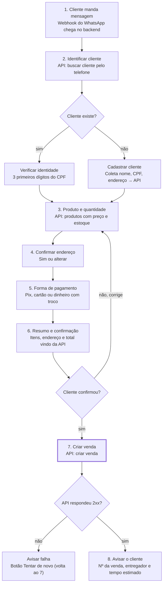

# Fluxo de criação de venda — RevGás AI Flow

> Extraído de [revgas-ai-flow.md](revgas-ai-flow.md). Descreve a conversa e a máquina de estados.

O fluxo tem 8 passos e só chama "criar venda" no passo 7, depois do "confirmo" do cliente. Pedido de atendente (e falha ao criar a venda, se o cliente quiser) transfere a conversa para um atendente no Chatwoot (F07, 2026-11-09; ver [Handoff para atendente](#handoff-para-atendente)). Sem o Chatwoot configurado (`CHATWOOT_MODE=off`), o bot volta a responder com o telefone da revenda.

## Diagrama

## Passo a passo

O estado do pedido (`OrderState.step`) vive no Redis por 15 min. Os valores de `Step` e o que cada um faz:

| Step | O que faz | Entrada esperada |
| --- | --- | --- |
| `askName` | Cliente novo: pede o nome | Texto |
| `askCpf` | Cliente novo: pede o CPF e cadastra | Texto (CPF inválido ou já usado → pede de novo) |
| `askCpfPrefix` | Cliente existente: pede os 3 primeiros dígitos do CPF (ver [Verificação de identidade](#verificação-de-identidade)) | Texto (3 dígitos) |
| `offerRepeat` | Cliente verificado: oferece repetir o último pedido (ver [Repetir último pedido](#repetir-último-pedido)) | Botão (`repeat:yes\|new`) |
| `chooseAddress` | Mostra os endereços salvos (≤ 2 em botões, mais em lista) | Botão / lista (`address:<i>`, `address:new`) |
| `askNewAddress` | Pede CEP ou endereço completo (ViaCEP ou IA) | Texto |
| `askAddressField` | Pede o campo que faltou no endereço | Texto |
| `confirmAddress` | Confirma o endereço montado | Botão (`address:ok`, `address:retype`) |
| `pickProduct` | Texto livre citou um produto ambíguo: lista só os candidatos | Lista (`product:<id>`) |
| `chooseProduct` | Lista produtos (≤ 10 em lista; acima disso 9 + busca) | Lista (`product:<id>`, `product:search`) |
| `searchProduct` | Busca produto por texto | Texto |
| `chooseQuantity` | Quantidade em botões (1, 2, outra) | Botão (`qty:*`) |
| `askQuantity` | Quantidade digitada | Texto numérico |
| `choosePayment` | Formas de pagamento (≤ 3 em botões) | Botão / lista (`pay:<TYPE>`) |
| `askNeedsChange` | Dinheiro: precisa de troco? | Botão (`change:no\|yes`) |
| `askChangeAmount` | Dinheiro: troco para quanto (acima do total; um valor só, "200 300" não vale) | Texto numérico |
| `summary` | Itens, endereço, pagamento e total vindo da API | Botão (`summary:confirm\|fix`) |
| `chooseCorrection` | O que corrigir | Botão (`fix:product\|address\|payment`) |
| `creatingSale` | Cria a venda (único POST, sem retry automático) | — |
| `saleFailed` | Falha ao criar: avisa e oferece "Tentar de novo" | Botão (`retry:sale`) |

Ao concluir, o estado é apagado e o bot envia o número da venda.

### Regra do `nextStep`

Depois de qualquer etapa, `nextStep` vai para **o que falta no pedido**, nesta ordem: endereço,
produto, quantidade, pagamento. No endereço, a ordem é: rascunho em andamento (`askAddressField`),
texto de endereço pendente (`askNewAddress`, que o transforma em rascunho) e, por fim,
`chooseAddress` se há salvos ou `askNewAddress`. No produto, se há candidatos do texto livre vai
para `pickProduct`; senão, `chooseProduct`. Com tudo
preenchido, calcula a cotação (sem preço para o pagamento → volta a `choosePayment`) e vai para
`askNeedsChange` (dinheiro sem troco definido) ou `summary`. Por isso "Corrigir" limpa só o campo
escolhido e o fluxo retoma dali.

### Comandos globais

Valem em qualquer etapa (`global-commands.ts`), nesta ordem: **emergência de gás** (ver
[Emergência de gás](#emergência-de-gás)), que vem antes de tudo; `cancelar` apaga o estado
(bloqueado em `creatingSale`); `atendente`/`humano`/`falar com alguem` e o botão "Falar com atendente" (id `handoff:request`) pedem o handoff (ver [Handoff para atendente](#handoff-para-atendente));
o botão "Fazer pedido" (id `order:start`) inicia o pedido (sem estado) ou repete a pergunta da etapa (com estado);
`desconto`/`promoção` responde que o preço é o da tabela e repete a pergunta; mensagem que não é
texto/botão/lista (áudio, imagem) pede texto e repete a pergunta. O estado não muda, exceto no cancelar.

## Emergência de gás

Mensagem que fala de vazamento ou cheiro de gás (`flow/emergency.ts`, `detectEmergency`) é tratada
**antes de qualquer outro comando e sem IA**, em qualquer etapa e também sem pedido em andamento,
**exceto com o atendente no controle** (handoff `active`, ver abaixo).

- **Detecção:** texto normalizado (sem acento e sem diferenciar maiúsculas). Vale frase como "vazamento", "vazando", "cheiro de gás", "gás escapando", e também a palavra de gás (`gás`, `glp`, `botijão`) a até 4 palavras de um termo de vazamento ("sinto cheiro forte no botijão"). "O gás acabou", "gás de cozinha" e "botijão vazio" não disparam.
- **Resposta:** texto fixo de segurança (feche o registro, não acenda fogo nem mexa em interruptores ou tomadas, abra portas e janelas, saia do local e ligue para os Bombeiros no 193), seguido da resposta do handoff com o motivo `emergency`.
- **Pedido:** o estado não muda. O botão de atendente não é preciso: o cliente já entra na fila (ou recebe o telefone da revenda, se não houver Chatwoot).
- **Já na fila (`queued`):** o texto de segurança e a resposta "Você já está na fila..." vão ao cliente como acima, e o bot também deixa a nota interna "Emergência: cliente relatou possível vazamento de gás" na conversa do Chatwoot.
- **Atendente no controle (`active`), decisão do usuário (2026-11-10):** o bot continua em silêncio. Ele não manda o texto de segurança: repassa a mensagem ao atendente como sempre e deixa a nota interna "Emergência: cliente relatou possível vazamento de gás" na conversa (`HandoffService.flagEmergency`). Falha do Chatwoot vira aviso no log e não impede o repasse. É a exceção ao "em qualquer etapa" desta seção.

## Verificação de identidade

Cliente que o telefone já identifica na RevGás precisa confirmar os 3 primeiros dígitos do CPF
antes de ver endereços ou pedidos (`askCpfPrefix`, em `flow/steps/customer.step.ts`). O telefone
pode ter mudado de dono.

- **Validade:** 15 dias, guardada no Redis por telefone + id do cliente na RevGás. Dentro do prazo o `start` pula a pergunta.
- **Sem CPF no cadastro, ou telefone bloqueado:** mensagem fixa com o telefone da revenda e a conversa termina (estado apagado). O bot não pede nem grava CPF de cadastro existente.
- **Erros:** 3 dígitos que não batem contam como tentativa; na 3ª o telefone fica bloqueado por 1 h e recebe o telefone da revenda. Acertar zera as tentativas.
- **Formato:** só conta como tentativa a entrada só numérica (dígitos, espaços, pontos ou traços, como `123`, `1 2 3` ou `123.`) com exatamente 3 dígitos. Texto com letras ("2 P13", "quero 1 botijão P13") nunca conta: segue para o texto livre abaixo. Sem pedido no texto, o bot pede de novo só os 3 dígitos.
- **Texto livre:** blocos soltos de 3 dígitos são removidos antes de o texto ir à IA, para o CPF nunca chegar ao prompt. Se não sobra texto, repete a pergunta.
- **Cliente novo:** quem acabou de se cadastrar (digitou o CPF inteiro) já fica verificado por 15 dias; o próximo pedido não pede os 3 dígitos.

## Repetir último pedido

Depois de verificado (`welcomeKnown`), se o cliente ainda não informou nada do pedido, o bot
oferece repetir o último (`offerRepeat`, em `flow/steps/repeat.step.ts`) com os botões "Repetir" e "Novo pedido".

- **Origem:** a venda não cancelada mais recente do cliente, só se tiver 1 produto, 1 pagamento e endereço completo.
- **Condições:** produto na lista do cliente, forma de pagamento ainda disponível e preço calculado por `tools.quote`. Se algo falhar (inclusive erro numa dessas consultas), segue o fluxo normal sem aviso.
- **Não oferece** se o texto livre inicial já trouxe produto, quantidade, pagamento ou endereço.
- **Repetir** preenche endereço, produto, quantidade, pagamento e preço atual e vai para `nextStep`: o resumo, ou a pergunta de troco se o pagamento for dinheiro. Nunca cria a venda sem o "Confirmar".
- **Novo pedido** segue o fluxo normal.
- **Digitado:** "sim" ou "repetir" valem como o botão "Repetir"; "novo", "novo pedido" ou "não" valem como "Novo pedido" (sem diferenciar maiúsculas nem acentos). Outro texto livre na oferta passa pela IA como em qualquer etapa.

## Lembrete de pedido parado

Se o cliente some no meio do pedido, o bot manda um lembrete aos 10 min sem mensagem dele
(`flow/reminder.ts`, enviado pelo `ReminderScheduler`).

- Uma vez por período parado; nova mensagem do cliente abre um novo período.
- Nunca durante `creatingSale`.
- Repete a pergunta da etapa atual com o aviso de que o pedido fica guardado por mais 5 minutos.
- Não renova o TTL de 15 min do pedido: só mensagem do cliente renova.
- O agendador varre a cada 30 s e fica desligado com `NODE_ENV=test`.

## Handoff para atendente

Guia técnico: [chatwoot.md](../guides/integrations/chatwoot.md). O estado do handoff fica no Redis por
telefone, separado do pedido (que expira em 15 min).

| Estado | Quem fala com o cliente | Como entra | Como sai |
| --- | --- | --- | --- |
| (nenhum) | Bot | n/a | Pedido de atendente → `queued`; mensagem humana no Chatwoot → `active` |
| `queued` | Bot (normal) | Pedido de atendente ou falha da venda | 1ª mensagem humana → `active`; venda criada pelo bot, conversa resolvida no Chatwoot ou 72 h → nenhum |
| `active` | Atendente; o bot só repassa ao Chatwoot | 1ª mensagem humana | Conversa resolvida no Chatwoot ou 24 h sem mensagem do atendente → nenhum |

- **Entrada na fila:** nota interna com o resumo (motivo, etapa, produto, quantidade, endereço, pagamento, total, nome; nunca CPF). Antes da verificação de identidade a nota não leva nome, endereço nem pedido. A resposta ao cliente é só o texto do handoff ("Já chamei um atendente...", "Você já está na fila..."); fora do horário (`SERVICE_HOURS`) o bot diz quando abre e pede que o cliente mande "oi" quando abrirmos.
- **Em `queued`** o bot segue o fluxo normal. Se ele cria a venda, a conversa é resolvida e o cliente sai da fila. "Cancelar" não tira da fila.
- **Em `active`** o pedido e o lembrete são apagados; mensagens do cliente vão só ao Chatwoot (não suportadas viram `[cliente enviou áudio]`); as do atendente chegam como `*Maria (atendente):* ...`. Mensagem de vazamento não recebe o texto de segurança: vai ao atendente com uma nota interna de emergência (ver [Emergência de gás](#emergência-de-gás)).
- **Espelho:** todas as mensagens do cliente e do bot são copiadas para uma conversa do Chatwoot por ciclo, depois do envio ao WhatsApp e sem nunca atrasar a resposta. CPF vira `[CPF ocultado]`.
- **Chatwoot indisponível ou desligado:** volta ao telefone da revenda (`STORE_PHONE`).

## Texto livre e fallback

A IA (`interpret`) só é chamada quando a etapa não entendeu a mensagem. Botões, listas e
palavras-chave funcionam sem IA, e os comandos globais (inclusive a emergência) vêm antes de tudo.
Código em `flow/free-text.ts` e `flow/intent.ts`; o serviço de IA fica em `src/modules/assistant/`.

| Situação | Comportamento |
| --- | --- |
| Botão, lista ou palavra-chave que a etapa entende | Igual antes. Sem IA |
| Comandos globais (emergência, cancelar, atendente, desconto) | Antes de tudo. Sem IA |
| Etapa de botão recebe texto que não entende | IA |
| `askName` | Texto com dígito, palavra de pedido ou `?` → IA; senão, validação de nome de sempre |
| `askCpf`, `askCpfPrefix`, `askQuantity`, `askChangeAmount` | Primeiro a validação de sempre; se falhar e o texto não for só números e pontuação, mas tiver ao menos 2 letras seguidas → IA; senão, o erro de sempre |
| Primeira mensagem (sem estado) | Só cumprimento (`oi`, `ola`, `bom dia`, `boa tarde`, `boa noite`, `opa`, `eai`, `e ai`, `menu`) → `start` sem IA; texto com 2 letras seguidas → IA antes do `start` |
| `askNewAddress`, `askAddressField`, `searchProduct` | Sem mudança (já recebem texto livre) |
| `creatingSale`, `saleFailed` | Nunca chama a IA |

O que a IA devolve e como vira pedido:

- Saída validada com Zod: `intent`, `topic`, `unknownProduct`, `products`, `quantity`, `payment`, `address`, `newAddress` e `confidence`. As intenções são `order`, `question`, `price`, `handoff`, `off_topic`, `offense` e `other`; `topic` (`hours`, `payments` ou `general`) só vem em `question`; `unknownProduct` é o item pedido que não está no catálogo.
- **Só `order` altera o pedido.** As outras intenções são respondidas pelo roteamento abaixo e o estado não muda ("quanto tá o P13?" não põe o P13 no pedido).
- Confiança abaixo de 0,6 ou falha da IA (`null`) → "Não entendi." e repete a pergunta. O estado não muda.
- Produto e pagamento só entram se existirem em `listProducts` / `listPaymentOptions`. Preço, total e troco nunca vêm da IA.
- Vários produtos que batem → `pickProduct` com a lista filtrada; quantidade e pagamento ditos são mantidos.
- O que o cliente disser **substitui** o que já estava no pedido. O bot responde "Anotado: ..." com o que mudou e `nextStep` pergunta só o que falta.
- Endereço: o texto vira rascunho pelo caminho de sempre (confirmação); "outro endereço" sem texto apaga o endereço e mostra `chooseAddress` ou `askNewAddress`.
- Mensagem que a IA classifica como `other` (sem relação com o pedido e fora das outras intenções) → "Não entendi." Dúvidas, preços e o resto seguem o roteamento da próxima seção.
- Quem quer comprar e também pergunta o preço ou o total ("quero 2 P13, quanto fica no pix?") é `order`: o pedido segue e o total aparece no resumo.

### Dúvidas, preço e guard rails

`routeIntent` (`flow/intent.ts`) responde pela intenção. Com pedido em andamento, a resposta vem
seguida da pergunta da etapa, e o estado não muda. Sem pedido, a resposta sai numa única mensagem
com o botão "Fazer pedido" (id `order:start`); nenhum pedido é criado nem lembrete agendado. Se a
resposta passa de 1024 caracteres (limite do corpo de botões do WhatsApp, por exemplo uma lista de
preços longa), ela vai em texto e os botões seguem numa mensagem curta ("Quer fazer um pedido?", ou
"Quer falar com um atendente ou fazer um pedido?" quando oferece o atendente).

| Intenção | Resposta | Quem responde |
| --- | --- | --- |
| `question`, assunto `hours` | "Nosso horário de atendimento: ..." + "Estamos abertos agora." ou "Estamos fechados agora." Sem `SERVICE_HOURS`: "Não tenho o horário..." + oferta de atendente | Código (`SERVICE_HOURS`), nunca a IA nem a base |
| `question`, assunto `payments` | "Aceitamos: Pix, Dinheiro e Cartão de crédito." (formas ativas na RevGás) | Código |
| `question`, assunto `general` | Resposta a partir da base de conhecimento ([knowledge.md](../guides/modules/knowledge.md)). Sem resposta: "Não tenho essa informação. Quer falar com um atendente?" + botão "Falar com atendente" | Base + IA, com checagens de saída |
| `price` | "Preços de hoje:" + uma linha por produto (`- P13: R$ 110,00` ou `- P13: a partir de R$ 105,00`) + "O total aparece no resumo do pedido." Se o cliente citou produtos do catálogo, só eles. Sem preço: "Não consegui consultar os preços agora..." + oferta | Código, só acordo base da RevGás (nunca o acordo do cliente); a IA só classifica |
| `handoff` | Entra na fila (motivo `customer_request`; em `saleFailed`, `sale_failed`) | Handoff |
| `off_topic` | "Sou o assistente da revenda: posso te ajudar com pedidos e dúvidas sobre gás e entrega." | Texto fixo |
| `offense` | 1ª vez: "Vamos manter a conversa respeitosa. Posso te ajudar com seu pedido de gás." Da 2ª em diante, o mesmo texto com o botão "Falar com atendente" | Texto fixo |
| `order` com produto que não vendemos | "Não temos {item}. Temos: P13, P45, Água 20L." (só letras, números, espaço e hífen, até 30 caracteres). Se outro produto da mesma mensagem foi aceito ("quero P13 e carvão"), o pedido segue e o aviso vem antes: "Não temos carvão. Anotado: Botijão P13." | Código |

- **Oferta de atendente:** o botão "Falar com atendente" (`handoff:request`) vem junto da resposta, antes da pergunta da etapa. Só o toque no botão aceita; "sim" digitado não.
- **Cliente travado:** 3 "Não entendi" seguidos viram "Não estou conseguindo entender. Quer falar com um atendente?" com o botão. O contador fica no Redis (TTL 15 min), fora do pedido, e zera quando uma mensagem é entendida.
- **Ofensas:** contador por telefone no Redis (TTL 1 h), fora do pedido.
- **Texto guiado:** quando a IA não entende em `askCpf`, `askCpfPrefix`, `askQuantity` ou `askChangeAmount`, o bot mostra o texto de ajuda da etapa (por exemplo, "Mande a quantidade...") em vez de "Não entendi.", até chegar ao 3º seguido.
- **Limite de IA por telefone:** `AI_CALLS_PER_PHONE_HOUR` (padrão 30 por hora). `interpret` custa 1, ler endereço em texto livre (`addressFromText`) custa 1 e responder dúvida custa 2. Passou do limite, o bot segue sem IA (como se ela estivesse fora do ar; no endereço, pede o endereço de novo). Se o Redis do limitador falhar, a chamada passa. Ver [environment.md](../guides/conventions/environment.md).
- **A base nunca informa** preço, porcentagem, horário de funcionamento nem formas de pagamento; essas respostas vêm do código.

**Primeira mensagem só com dúvida.** Se a primeira mensagem é uma dúvida (ou preço, fora do assunto etc.), o bot responde e mostra o botão "Fazer pedido". Não cria pedido nem pede identificação até o cliente tocar.

**Identificação primeiro.** Na primeira mensagem, o que foi dito fica guardado (produto, quantidade, pagamento e
endereço como texto pendente) e o `start` segue: cliente novo dá nome e CPF; cadastrado confirma os 3 primeiros dígitos do CPF. A saudação (boas-vindas) vem primeiro, depois o "Anotado: ..." e a pergunta seguinte. Em `askName`, texto com palavra de pedido vale como nome só quando a IA responde com confiança que não é pedido nem pergunta e o texto é um nome válido; com a IA fora do ar ou incerta, o bot diz "Não entendi" e pede o nome de novo. Texto
livre em `askName`/`askCpf`/`askCpfPrefix` anota os campos, mas repete a pergunta de identificação. Quando o
cliente fica conhecido, o produto guardado é conferido de novo com a lista dele e descartado se não estiver nela.

## Atalhos e transições especiais

- **Fora de ordem (passos 3–5):** se o cliente escreve "2 botijões no Pix pra mesma casa", a IA extrai tudo de uma vez e o bot só pergunta o que faltou (ver [Texto livre e fallback](#texto-livre-e-fallback)).
- **Repetir último pedido:** cliente conhecido e verificado pode ir direto do passo 2 para o passo 6 (ver [Repetir último pedido](#repetir-último-pedido)).
- **Pedido de atendente:** de qualquer estado, entra na fila do Chatwoot (ver [Handoff para atendente](#handoff-para-atendente)); o pedido em andamento não muda. Em `saleFailed` o motivo é `sale_failed`; nas demais, `customer_request`.
- **Falha ao criar a venda (`saleFailed`):** dois botões, "Tentar de novo" e "Falar com atendente".
- **Pedido de desconto:** resposta fixa ("o preço é o da tabela"); o estado não muda.
- **Dúvida no meio do fluxo:** respondida pela base ou pelo código e a pergunta da etapa é repetida; o estado não muda (ver [Dúvidas, preço e guard rails](#dúvidas-preço-e-guard-rails)). Sem resposta, oferece o atendente.
- **Emergência de gás:** texto de segurança e fila do atendente, em qualquer etapa; com o atendente no controle (`active`), só repasse e nota interna (ver [Emergência de gás](#emergência-de-gás)).
- **Expiração e lembrete:** o estado no Redis tem TTL de 15 min; se o cliente sumir, o carrinho expira. Aos 10 min sem mensagem, o bot manda um lembrete (ver [Lembrete de pedido parado](#lembrete-de-pedido-parado)).
- **Fallback da IA:** se a IA falhar, demorar, passar do limite por telefone ou não entender, o bot diz "Não entendi." e repete a pergunta com os botões do estado atual (3 seguidos oferecem o atendente).

## Observações sobre o fluxo

- O diagrama não mostra o atalho "repetir último pedido" nem a saída da verificação (telefone da revenda); eles só aparecem no texto.
- "Corrigir" sempre volta ao passo 3. Vale perguntar *o que* corrigir (produto, endereço ou pagamento) e voltar só àquele passo.
- O passo 8 promete "tempo estimado", mas a API não fornece esse dado nem webhook de status: dá para informar só o status e o entregador, consultando a venda.
- O preço vem dos acordos da RevGás e pode depender da forma de pagamento. Se depender, o passo 3 mostra no máximo um preço de referência e o total definitivo só sai no passo 6, depois do pagamento.
