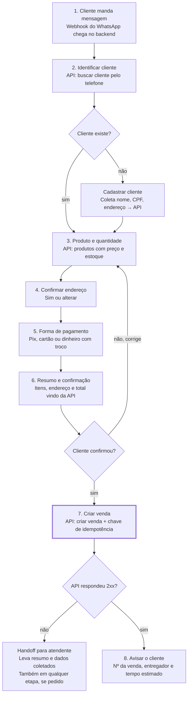

# Fluxo de criação de venda — RevGás AI Flow

> Extraído de [revgas-ai-flow.md](revgas-ai-flow.md). Descreve a conversa e a máquina de estados.

O fluxo tem 8 passos e só chama "criar venda" no passo 7, depois do "confirmo" do cliente. Qualquer falha da API ou pedido de atendente vira handoff.

## Diagrama

## Passo a passo

| Passo | Estado | Bot faz | Chamada à API | Entrada esperada | Falha → |
| --- | --- | --- | --- | --- | --- |
| 1 | `INICIO` | Recebe webhook, normaliza telefone | — | Qualquer mensagem | Pedir confirmação do número |
| 2 | `IDENTIFICANDO` | Busca cliente pelo telefone | Buscar cliente | — | Não encontrado → `CADASTRO` |
| 2a | `CADASTRO` | Coleta nome, CPF, endereço | Cadastrar cliente | Texto | 2 tentativas → `HANDOFF` |
| 3 | `PRODUTO` | Lista produtos (lista interativa) e quantidade | Listar produtos | Lista / texto livre (IA) | Sem estoque → alternativa ou handoff |
| 4 | `ENDERECO` | Mostra endereço salvo: "Sim" / "Alterar endereço" | Listar/atualizar endereços | Botão / endereço digitado (IA ou ViaCEP) | Endereço incompleto → pedir o que faltou |
| 5 | `PAGAMENTO` | Pix, cartão ou dinheiro (+ troco) | Listar formas de pagamento | Botão / texto | Troco < total → pedir de novo |
| 6 | `RESUMO` | Itens, endereço, pagamento e total calculado no backend | — | Botão "Confirmar" / "Corrigir" | "Corrigir" → volta ao passo 3 |
| 7 | `CRIANDO_VENDA` | Monta o corpo e envia com chave de idempotência | **Criar venda** | — | 5xx/timeout → retry com backoff; 4xx → `HANDOFF` |
| 8 | `CONCLUIDO` | Envia nº da venda, entregador e tempo estimado; salva no Postgres | Consultar venda/entrega | "Meu gás chegou?" | Falha ao salvar → alerta no log |
| — | `HANDOFF` | Transfere ao atendente com resumo e dados coletados | — | — | — |

> Os nomes de estado são uma proposta para implementar a máquina de estados; não constam no documento original.

## Atalhos e transições especiais

- **Fora de ordem (passos 3–5):** se o cliente escreve "2 botijões no Pix pra mesma casa", a IA extrai tudo de uma vez e o bot só pergunta o que faltou.
- **Repetir último pedido:** cliente conhecido pode ir direto do passo 2 para o passo 6.
- **Handoff global:** de qualquer estado, se o cliente pedir atendente ou a IA tiver confiança baixa.
- **Dúvida no meio do fluxo (FAQ):** responde e mantém o estado atual.
- **Expiração:** o estado no Redis tem TTL; se o cliente sumir, o carrinho expira.
- **Fallback da IA:** se a IA falhar ou demorar, o bot reapresenta os botões do estado atual.

## Observações sobre o fluxo

- O diagrama não mostra o handoff "em qualquer etapa" nem o atalho "repetir último pedido"; os dois só aparecem no texto.
- "Corrigir" sempre volta ao passo 3. Vale perguntar *o que* corrigir (produto, endereço ou pagamento) e voltar só àquele passo.
- O passo 8 promete "tempo estimado", mas nenhuma operação da API confirmada fornece esse dado.
