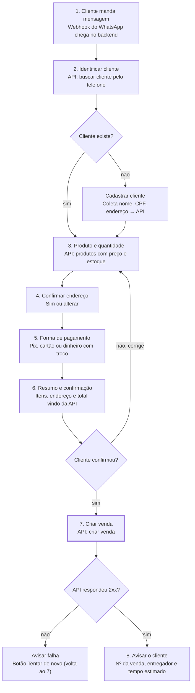

# Fluxo de criação de venda — RevGás AI Flow

> Extraído de [revgas-ai-flow.md](revgas-ai-flow.md). Descreve a conversa e a máquina de estados.

O fluxo tem 8 passos e só chama "criar venda" no passo 7, depois do "confirmo" do cliente. Não há atendente humano (decisão de 2026-10-21): falha da API vira "Tentar de novo" e pedido de atendente recebe o telefone da revenda.

## Diagrama

## Passo a passo

O estado do pedido (`OrderState.step`) vive no Redis por 15 min. Os valores de `Step` e o que cada um faz:

| Step | O que faz | Entrada esperada |
| --- | --- | --- |
| `askName` | Cliente novo: pede o nome | Texto |
| `askCpf` | Cliente novo: pede o CPF e cadastra | Texto (CPF inválido ou já usado → pede de novo) |
| `askMissingCpf` | Cliente existente sem CPF: pede e salva | Texto |
| `chooseAddress` | Mostra os endereços salvos (≤ 2 em botões, mais em lista) | Botão / lista (`address:<i>`, `address:new`) |
| `askNewAddress` | Pede CEP ou endereço completo (ViaCEP ou IA) | Texto |
| `askAddressField` | Pede o campo que faltou no endereço | Texto |
| `confirmAddress` | Confirma o endereço montado | Botão (`address:ok`, `address:retype`) |
| `chooseProduct` | Lista produtos (≤ 10 em lista; acima disso 9 + busca) | Lista (`product:<id>`, `product:search`) |
| `searchProduct` | Busca produto por texto | Texto |
| `chooseQuantity` | Quantidade em botões (1, 2, outra) | Botão (`qty:*`) |
| `askQuantity` | Quantidade digitada | Texto numérico |
| `choosePayment` | Formas de pagamento (≤ 3 em botões) | Botão / lista (`pay:<TYPE>`) |
| `askNeedsChange` | Dinheiro: precisa de troco? | Botão (`change:no\|yes`) |
| `askChangeAmount` | Dinheiro: troco para quanto (≥ total) | Texto numérico |
| `summary` | Itens, endereço, pagamento e total vindo da API | Botão (`summary:confirm\|fix`) |
| `chooseCorrection` | O que corrigir | Botão (`fix:product\|address\|payment`) |
| `creatingSale` | Cria a venda (único POST, sem retry automático) | — |
| `saleFailed` | Falha ao criar: avisa e oferece "Tentar de novo" | Botão (`retry:sale`) |

Ao concluir, o estado é apagado e o bot envia o número da venda.

### Regra do `nextStep`

Depois de qualquer etapa, `nextStep` vai para **o que falta no pedido**, nesta ordem: endereço
(`chooseAddress` se há salvos, senão `askNewAddress`), produto, quantidade, pagamento. Com tudo
preenchido, calcula a cotação (sem preço para o pagamento → volta a `choosePayment`) e vai para
`askNeedsChange` (dinheiro sem troco definido) ou `summary`. Por isso "Corrigir" limpa só o campo
escolhido e o fluxo retoma dali.

### Comandos globais

Valem em qualquer etapa (`global-commands.ts`): `cancelar` apaga o estado (bloqueado em
`creatingSale`); `atendente`/`humano` responde com o telefone da revenda (`STORE_PHONE`);
`desconto`/`promoção` responde que o preço é o da tabela e repete a pergunta; mensagem que não é
texto/botão/lista (áudio, imagem) pede texto e repete a pergunta. O estado não muda, exceto no cancelar.

## Atalhos e transições especiais

- **Fora de ordem (passos 3–5):** se o cliente escreve "2 botijões no Pix pra mesma casa", a IA extrai tudo de uma vez e o bot só pergunta o que faltou.
- **Repetir último pedido:** cliente conhecido pode ir direto do passo 2 para o passo 6.
- **Pedido de atendente:** de qualquer estado, resposta fixa com o telefone da revenda; o estado não muda.
- **Pedido de desconto:** resposta fixa ("o preço é o da tabela"); o estado não muda.
- **Dúvida no meio do fluxo (FAQ):** responde e mantém o estado atual.
- **Expiração:** o estado no Redis tem TTL; se o cliente sumir, o carrinho expira.
- **Fallback da IA:** se a IA falhar ou demorar, o bot reapresenta os botões do estado atual.

## Observações sobre o fluxo

- O diagrama não mostra o atalho "repetir último pedido"; ele só aparece no texto.
- "Corrigir" sempre volta ao passo 3. Vale perguntar *o que* corrigir (produto, endereço ou pagamento) e voltar só àquele passo.
- O passo 8 promete "tempo estimado", mas a API não fornece esse dado nem webhook de status: dá para informar só o status e o entregador, consultando a venda.
- O preço vem dos acordos da RevGás e pode depender da forma de pagamento. Se depender, o passo 3 mostra no máximo um preço de referência e o total definitivo só sai no passo 6, depois do pagamento.
